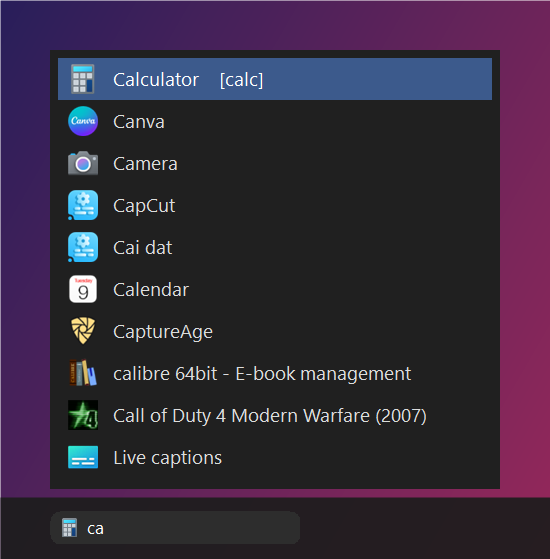

# Lanceur

A tiny app-launcher search box that lives **inside the Windows 11 taskbar**, right next to the clock.
Type a few letters, it suggests your apps with their icons, press **Enter** to launch.



Written in plain PowerShell + WinForms (with a bit of inline C#): nothing to install, it runs on the
PowerShell 5.1 that ships with Windows. The interface is in French.

## Features

- **Instant search** across every Start-menu app (classic and Microsoft Store), Control Panel items and tasks
  (Indexing Options, "Show hidden files and folders"...), common Settings pages (Display, Wi-Fi, Default apps...,
  also found by French words: `affichage`, `son`, `imprimantes`...) and anything in the `raccourcis` folder.
  Non-app results carry a small grey tag (*Parametres*, *Tache*, *Raccourci*...). It matches the start of the
  name, any word (`wifi` finds *Wi-Fi*), initials (`vsc`), or letters in order from the start of a word (`ntpd` → Notepad), and ignores accents.
  Ranking runs in C# (< 1 ms per keystroke).
- **App icons** in the suggestions, and the selected app's icon in the box itself.
- **Learns what you use**: frequently launched apps move to the top.
- **Aliases**: type `ch=chrome` then Enter, and `ch` now launches Google Chrome.
  Right-click a suggestion → *Donner un alias à cette appli*, or type `:alias` to open the alias manager.
- **Alias manager** (`:alias`, or right-click the bar → *Gérer les alias...*), same design as basedhound's:
  add at the top (Enter), double-click (or F2) an alias or a target to edit it in place, delete with the × (red on
  hover) or Del. Targets that lead nowhere show in orange. Changes are saved instantly, and the bar stays usable
  while the window is open, so a new alias can be tried right away. Typing `:alias` again brings the open window
  forward; `alias.txt` edited by hand meanwhile is reloaded (*Ouvrir alias.txt* link at the bottom).
- **Your own shortcuts**: drop any `.lnk`, `.url`, `.exe` or document into the `raccourcis` folder
  (right-click the bar → *Ouvrir le dossier des raccourcis*) and it shows up under its file name.
  Put them in subfolders to sort them: `raccourcis\Travail\Compta.lnk` is tagged *Travail*, and typing
  `travail` lists everything in that folder.
- **Web apps sorted by browser**: sites installed as apps from Brave, Chrome, Edge… are tagged with their
  browser, and typing `brave` lists your Brave apps.
- **Built-in actions**: *Arrêter le PC* (or *Éteindre*, *Shut down*), *Redémarrer*, *Se déconnecter*, *Veille*,
  *Verrouiller* and *Vider la corbeille*. The ones that close your apps or delete files ask first, with **Yes** as the
  default: `arr`, Enter, Enter.
- **Games, on demand**: installed Steam and GOG games stay out of the normal results. Type `steam ` first:
  `steam age` suggests Age of Empires, and `steam ` alone lists every installed game (the list scrolls). Same with `gog `.
  Give a game an alias to launch it directly. Installed or uninstalled games show up the next time you click the bar.
- A shortcut in `raccourcis` named like an installed app **replaces** it in the search (e.g. a `Google Calendar.lnk`
  that opens Calendar straight on Tasks). Keep the icons your shortcuts use in `raccourcis\.icons` (ignored by the search).
- An alias with a partial name (`wi = Wi-F`) also finds shortcuts, Settings pages, games and actions.
- Dark right-click menus.
- Paths, URLs and commands work too.
- **Site icons**: an alias that opens a web site (`yt = https://www.youtube.com`, or a browser followed by a URL)
  shows the site's own icon. It's downloaded once from the site itself (favicon.ico, apple-touch-icon.png, or the
  icon the home page declares), in the background, and kept in `%APPDATA%\Lanceur\favicons`.
  To use your own icon for a site, drop `<site>.png` (or `.ico`) in `raccourcis\.icons`, e.g. `acck.io.png`:
  it wins over the downloaded one.
- **Program + arguments** as an alias target: `yt = "C:\Program Files\BraveSoftware\Brave-Browser\Application\brave.exe" https://www.youtube.com`
  opens YouTube in a new Brave tab even if another browser is the default.
- **Windows key**: tap it alone to open the bar instead of the Start menu (Win+E and other shortcuts still
  work, Ctrl+Esc opens Start). Global hotkey **Ctrl+Alt+Space** too.
- Works with the taskbar at the top or bottom of the screen, on the **right** (next to the clock) or the
  **left** (in place of the Start button): right-click the bar → *A gauche* / *A droite*.
- Can hide the taskbar's Start button (`$MasquerDemarrer`); the Start menu still opens with **Ctrl+Esc**.
  Only works with a classic taskbar (e.g. ExplorerPatcher); on the stock Windows 11 taskbar it does nothing.
- Icons are preloaded in the background, so suggestions always appear instantly.
- Stays on top of the taskbar (even when the Start menu opens) and repositions itself when the
  taskbar or screen changes.
- Hides with the taskbar when an app goes full screen (videos, games, slideshows) and comes back afterwards.
- Restarts automatically if it is ever closed by accident.
- Logs starts, stops, every launch and launch errors to `%APPDATA%\Lanceurarre.log`.

## Install

1. Download the repo (*Code → Download ZIP*) and unzip it anywhere.
2. Right-click `Installer.ps1` → **Run with PowerShell**. No admin rights needed.

This registers a per-user scheduled task named `LanceurBarre` that starts the bar at logon and checks
every 5 minutes that it is still running (no console window flashes).

**Uninstall**: right-click the bar → *Quitter la barre*, then run

```powershell
Unregister-ScheduledTask -TaskName LanceurBarre -Confirm:$false
```

If you quit the bar from its menu, it stays closed until the next reboot, or until you double-click
`Demarrer la barre.bat`.

**Moved the folder?** Double-click `Demarrer la barre.bat` in its new location: it notices the task points
to the old folder and re-registers it.

## Usage

| Action | Key |
|---|---|
| Focus the bar | click it, tap **Windows**, or **Ctrl+Alt+Space** |
| Open the real Start menu | **Ctrl+Esc** |
| Move through suggestions | **Up / Down** |
| Launch | **Enter** or click |
| Clear | **Ctrl+Space** (stay in the bar) or **Esc** (clear and go back to the previous window) |
| Delete the last word | **Ctrl+Backspace** |
| Create an alias | `alias=app name`, then Enter |
| Manage aliases | `:alias`, or right-click the bar |
| Move the bar left / right | right-click the bar → *A gauche* / *A droite* |
| Refresh the app list / quit | right-click the bar |

## Settings

At the top of `LanceurBarre.ps1`:

```powershell
$Largeur       = 200     # width of the search box (logical pixels)
$MargeDroite   = 290     # only used if the clock area can't be found
$ToucheWindows = $true   # tap the Windows key alone to open the bar ($false = normal Start menu)
$MasquerDemarrer = $false # hide the taskbar's Start button
```

The left / right position is chosen from the right-click menu and saved in `%APPDATA%\Lanceur
eglages.json`.
On the left, the Start button is hidden (the bar takes its place) and comes back when the bar is closed.

## Files

| File | Purpose |
|---|---|
| `LanceurBarre.ps1` | the search box in the taskbar |
| `LanceurCore.ps1` | app list, search engine (C#), aliases, usage history, alias manager window |
| `Lanceur.ps1` / `Lanceur.bat` | standalone pop-up window version (no taskbar box), same search engine |
| `Installer.ps1` | registers the scheduled task and starts the bar |
| `Demarrer la barre.bat` | reopens the bar, even after *Quitter la barre*, and repairs the task if the folder moved |
| `raccourcis/` | your own shortcuts and files, searchable by file name (not versioned) |
| `alias.txt` | your aliases, created on first run (not versioned) |

Usage history and the log live in `%APPDATA%\Lanceur`.

## How it works (for the curious)

- Apps come from `Get-StartApps` and are launched through `shell:AppsFolder\<AppID>`, which covers
  both desktop and Store apps.
- Icons are fetched with `IShellItemImageFactory` on the same `shell:AppsFolder` items, alpha channel kept.
- The box is a borderless WinForms window owned by `Shell_TrayWnd`, so Windows keeps it above the taskbar.
- The suggestion list is a `WS_EX_NOACTIVATE` window that also answers `WM_MOUSEACTIVATE` with `MA_NOACTIVATE`,
  so neither typing nor clicking a suggestion ever takes the focus away from the box.
- The scheduled task asks Explorer to start the bar (`Shell.Application.ShellExecute`) instead of running it
  directly: a process started by Task Scheduler is treated as a background process and can't always take the focus.
